<div align="center">

# 🍁 Maple Bay Mayhem

**An original 3D open-world sandbox game for Linux — written from scratch in C with OpenGL and X11.**

Drive any car, fly planes and helicopters, fight street gangs, dodge the police,
run missions for the locals and hop between three islands.

[](LICENSE)


Created by **[Janib Soomro](https://ormoos.com)** · 🌐 [ormoos.com](https://ormoos.com)

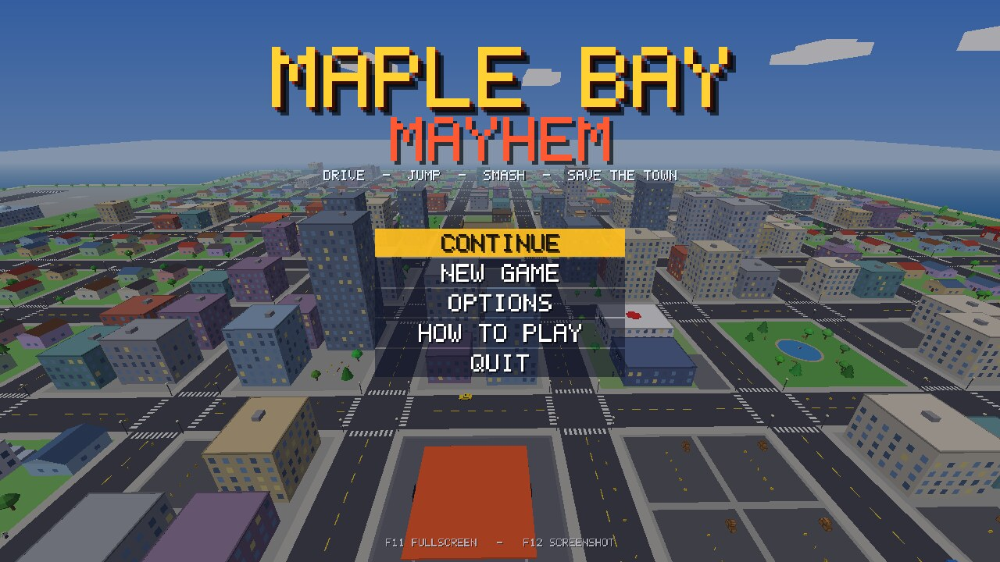

</div>

---

## 📑 Contents

- [Highlights](#-highlights)
- [Screenshots](#-screenshots)
- [Getting Started](#-getting-started)
- [Controls](#-controls)
- [What's in the Game](#-whats-in-the-game)
- [Testing](#-testing)
- [Project Structure](#-project-structure)
- [Author](#-author)
- [License](#-license)

---

## ✨ Highlights

- 🏙️ **Three handcrafted islands** — a sprawling city, a desert resort and a snowy mountain town, each with its own airport.
- 🚗 **Drive anything** — borrow cars off the street, drift, hit ramps, wreck them, refuel them.
- ✈️ **Real flight** — planes need a runway, helicopters hover, and you can bail out with a parachute.
- 🔫 **Combat & gang wars** — seven weapons with four upgrade paths each, and turf you can claim.
- 🚓 **Police AI** — a 1–5 star wanted system with arrests at low levels and gunfire at high ones.
- 🎯 **16 story missions** across the islands, plus shops, collectibles and upgrades.
- 🎵 **Synthesized audio** — every sound effect and music track is generated in code.
- ⚙️ **Zero engine, zero assets** — one small C codebase (~9.7k lines), no game engine, no image or audio files.

---

## 📸 Screenshots

<table>
  <tr>
    <td>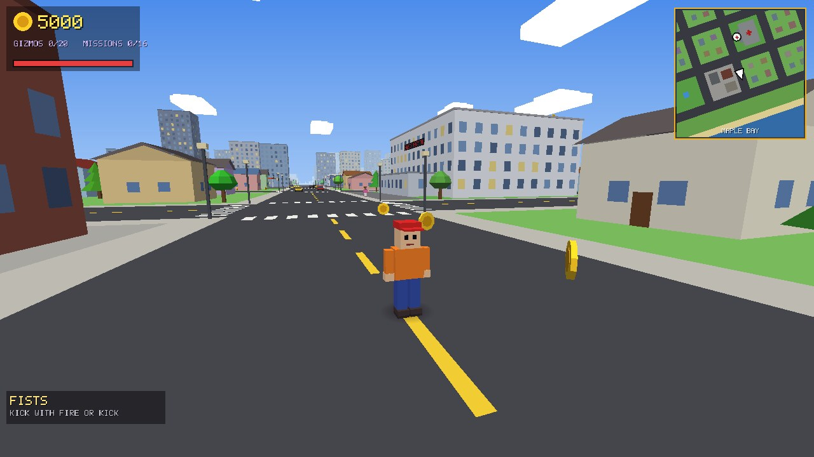</td>
    <td>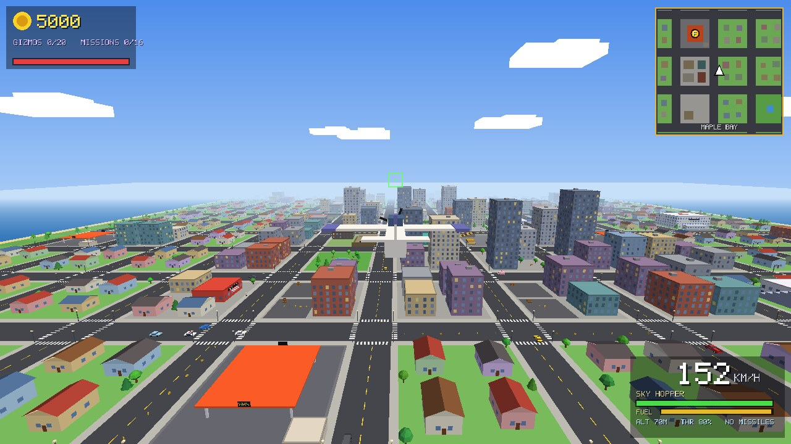</td>
  </tr>
  <tr>
    <td align="center"><sub><b>Streets of Maple Bay</b></sub></td>
    <td align="center"><sub><b>Flying the Sky Hopper over the city</b></sub></td>
  </tr>
  <tr>
    <td>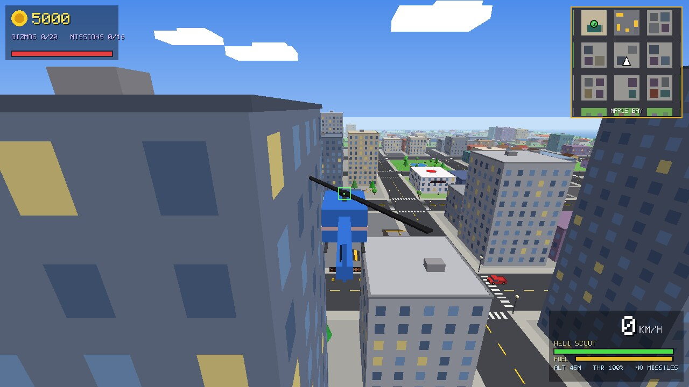</td>
    <td>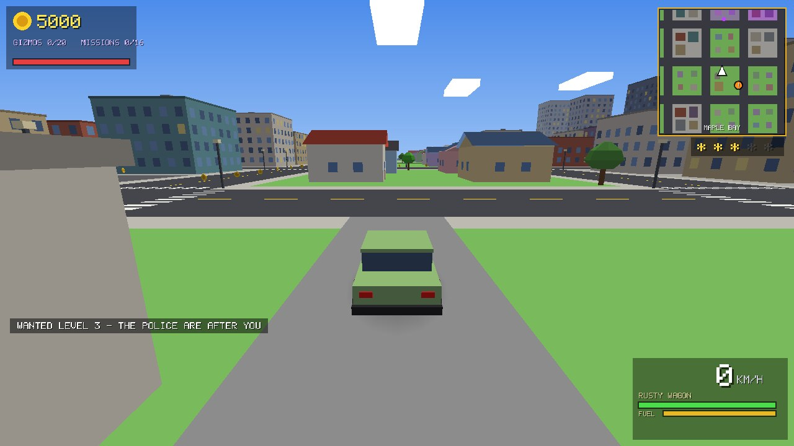</td>
  </tr>
  <tr>
    <td align="center"><sub><b>Heli Scout among the skyscrapers</b></sub></td>
    <td align="center"><sub><b>Wanted level 3 — the police are after you</b></sub></td>
  </tr>
  <tr>
    <td>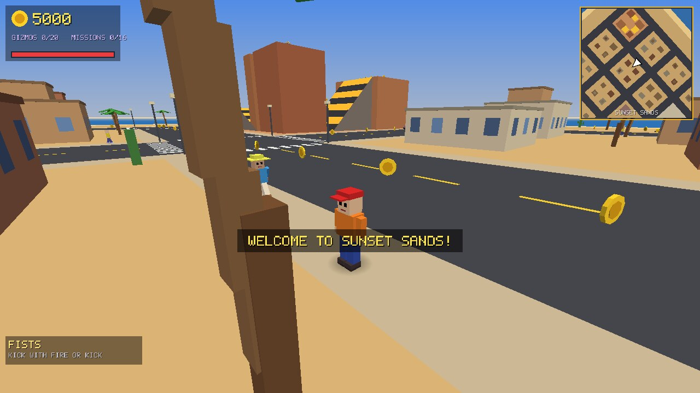</td>
    <td>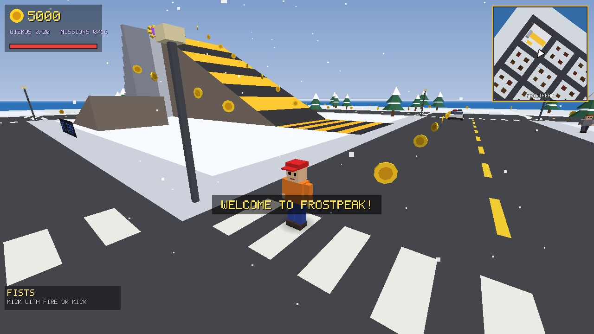</td>
  </tr>
  <tr>
    <td align="center"><sub><b>Sunset Sands</b></sub></td>
    <td align="center"><sub><b>Frostpeak and its giant ski jump</b></sub></td>
  </tr>
  <tr>
    <td>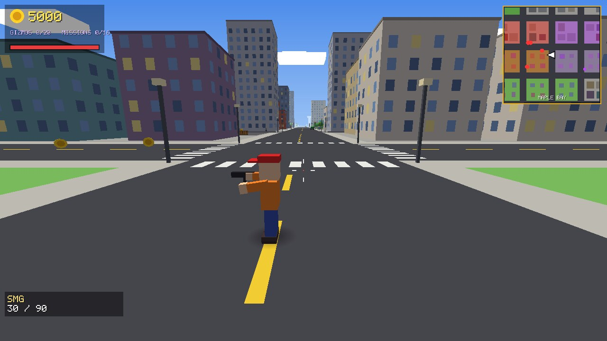</td>
    <td>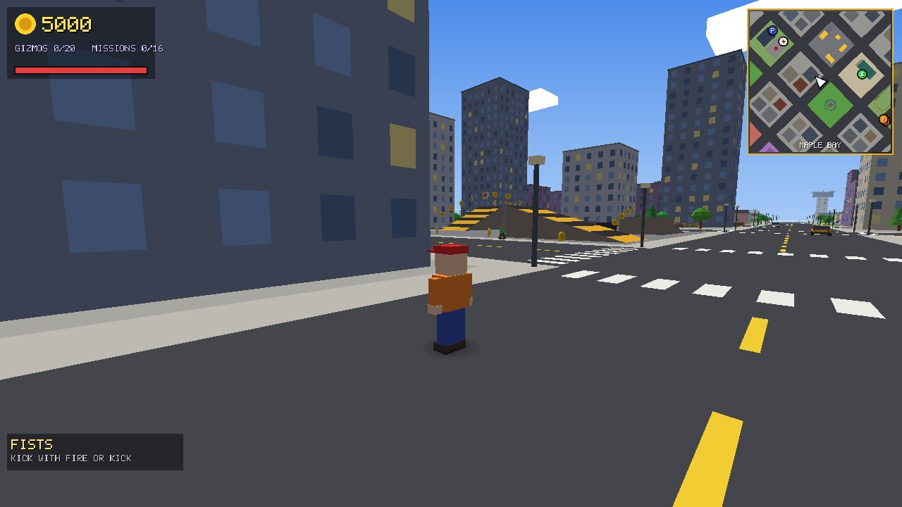</td>
  </tr>
  <tr>
    <td align="center"><sub><b>Taking on the gangs</b></sub></td>
    <td align="center"><sub><b>Downtown</b></sub></td>
  </tr>
  <tr>
    <td>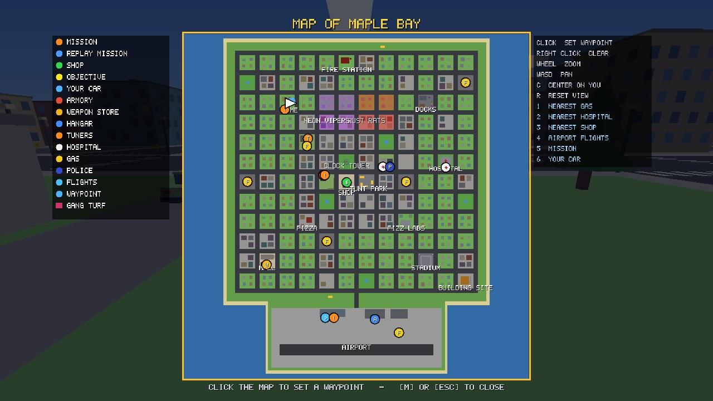</td>
    <td>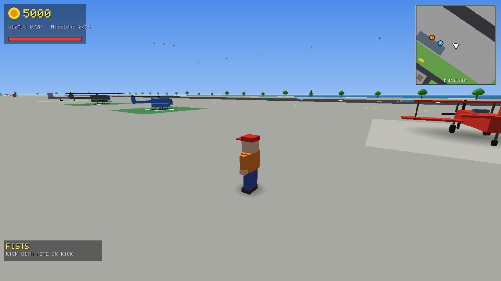</td>
  </tr>
  <tr>
    <td align="center"><sub><b>Map, waypoints &amp; GPS</b></sub></td>
    <td align="center"><sub><b>The airport apron</b></sub></td>
  </tr>
  <tr>
    <td>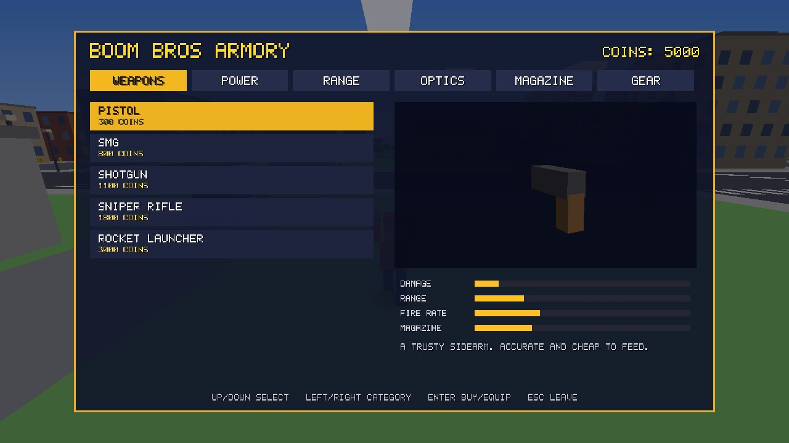</td>
    <td>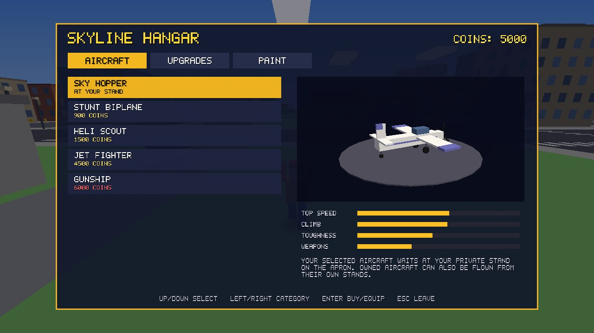</td>
  </tr>
  <tr>
    <td align="center"><sub><b>Boom Bros Armory</b></sub></td>
    <td align="center"><sub><b>Skyline Hangar</b></sub></td>
  </tr>
</table>

> 💡 Press **F12** in game to save your own screenshots to `screenshots/`.

---

## 🚀 Getting Started

### Requirements

| Requirement | Notes |
|---|---|
| Linux with X11 | Runs under Xorg or XWayland |
| C compiler + `make` | `gcc` or `clang` |
| X11 & OpenGL dev headers | `libx11-dev`, `libgl-dev` (Mesa) |
| ALSA *(optional)* | `libasound.so.2`, loaded at runtime — the game runs silently without it |

On Debian / Ubuntu:

```sh
sudo apt install build-essential libx11-dev libgl-dev
```

### Build & Run

```sh
git clone https://github.com/Soomrojb/maple_bay_mayhem.git
cd maple_bay_mayhem
./run.sh            # builds if needed, then starts the game
```

Or manually:

```sh
make && ./maplebay
```

### Command-line options

| Option | Description |
|---|---|
| `--windowed` | Start in a window |
| `--fullscreen` | Start fullscreen |
| `--help` | Show usage |

In game, **F11** toggles fullscreen and **F12** saves a screenshot.

---

## 🎮 Controls

All controls are rebindable in **Options › Controls & Key Bindings**.

| Action | Keys |
|---|---|
| Move / accelerate / brake / steer / throttle | `W` `A` `S` `D`, or the arrow keys |
| Jump / open parachute (on foot) | `Space` |
| Sprint (on foot) / Nitro (driving, once bought) | `Left Shift` |
| Enter / exit vehicle, talk, shop | `E` |
| Kick | `F` (or Fire with bare hands) |
| Fire weapon / aircraft guns | Left mouse button or `V` |
| Aim / scope | Right mouse button or `X` |
| Reload | `R` |
| Next / previous weapon | `Q` / `Z`, or the mouse wheel |
| Handbrake (drift) | `Space` or `Left Ctrl` |
| Horn | `H` or right mouse button |
| Climb / pull up (flying) | `Space` |
| Descend / dive (flying) | `Left Ctrl` |
| Fire missile (flying) | `G` or right mouse button |
| Call your car | `C` |
| Reset (unstick) vehicle | `R` |
| Camera | Mouse, or `J` `L` `I` `K` |
| Map | `M` or `Tab` |
| Pause | `Esc` (always works) or `P` |

Each action has a primary and a secondary key, and each binding belongs to a
context (on foot, driving, flying). The same key can do different jobs in
different contexts, so `Space` jumps on foot, drifts in a car and climbs in an
aircraft. Bindings that clash within a context are shown in orange. Settings
are saved in `config.ini` next to the game, and you can also edit that file by
hand.

---

## 🗺️ What's in the Game

### Three islands

| Island | Description |
|---|---|
| **Maple Bay** | The big city — 144 blocks. The original town sits in the middle, surrounded by new districts: Bayside Hospital, the Bayview Mall, Maple Stadium, a fire station, a building site you can climb, more parks and gas stations. |
| **Sunset Sands** | A desert resort with the Lucky Sands Casino, the Devil's Canyon stunt mesas, palm trees, an oasis and the Lock & Load gun store. |
| **Frostpeak** | A snowy mountain town with a giant ski jump, a frozen lake, log cabins, falling snow and a Boom Bros Armory branch. |

**Island hopping:** book a flight (75 coins) at the FLIGHTS desk in any airport
terminal, or fly your own plane or helicopter out over the open sea and pick a
destination from the flight plan. You arrive in the air, still flying.

### Getting around

- **Map & waypoints** (`M`) — click anywhere to drop a waypoint, then follow the
  blue GPS line on the map and minimap and the blue beacon in the world. The
  mouse wheel zooms, `WASD` pans, `C` centres on you and `R` resets the view.
  Keys `1`–`6` set quick waypoints: nearest gas, nearest hospital, nearest shop,
  the airport flights desk, your mission and your car.
- **Cars** — borrow any car on the street or call your own with `C`. Ramps,
  drifting, damage and wrecks. Cars burn **fuel**, so stop at a gas station
  (F on the map) to refuel for a few coins.
- **Planes & helicopters** — the airport has a Sky Hopper, a Stunt Biplane and a
  Heli Scout that anyone can fly. The Jet Fighter and Gunship can be bought at
  Skyline Hangar. Planes need speed down the runway before they pull up;
  helicopters climb straight up and hover. Bail out in mid-air and press Jump to
  open your parachute. Aircraft have nose guns, and missile pods can be fitted.

### Combat & crime

- **Weapons** — pistol, SMG, shotgun, sniper rifle (with scope), rocket launcher,
  assault rifle and grenade launcher. Each can be upgraded in four ways: power,
  range, optics and magazine. You also have health, body armor and max-health
  training. If you run out of health you wake up at Maple Medical with a small bill.
- **Gang wars** — the Rust Rats and the Neon Vipers hold turf north of the clock
  tower and shoot it out where their territory meets. Take down 8 members in a
  turf block to claim it, and claimed turf pays you every minute.
- **Police** — patrol cars drive around town and respond to gunfire. They go
  after gang members, and after you if you hurt people or damage property in
  front of them. Your wanted level (1–5 stars) brings more cars. At low levels
  officers try to arrest you ("BUSTED", with a fine); at high levels they open
  fire. Run far away, or lie low and stay out of trouble, and the stars fade.

### 16 missions

One mission on each new island (*Desert Dash* and *Summit Scramble*), plus three
story lines on Maple Bay:

- **The town story** — checkpoints, pizza delivery, a race and two chases.
- **The airport** — a flight-school ring course and rooftop helicopter landings.
- **The armory and gangs** — a shooting range, a turf war, shooting down rogue
  drones, and a final battle with the Viper gunship.

### Shops

| Shop | Map icon | Sells |
|---|:-:|---|
| **Bolt & Bargain** | `$` | Cars, outfits and perks |
| **Boom Bros Armory** | `G` | Weapons, ammo, weapon upgrades and gear |
| **Skyline Hangar** | `A` | Aircraft, aircraft upgrades (engine, power, armor, guns, missiles, fuel tank) and paint jobs |
| **Turbo Tuners** | `T` | Car engine, turbo, armor, fuel tank and paint |
| **Lock & Load Weapon Exchange** | `W` | Every weapon (including two exclusives), weapon upgrades, and **sell-back** for half of what you paid for the gun, its upgrades and its ammo. Found in the Bayview Mall and on Sunset Sands. |

### And more

Coins, crates, **20 hidden Golden Gizmos** (10 on Maple Bay, 5 on each other
island), autosave after missions and purchases (`savegame.dat`), and manual save
from the pause menu.

---

## 🧪 Testing

```sh
make test
```

Runs **39 scripted gameplay tests** by injecting real input: driving, jumping,
the tower climb, taking off and flying a plane, flying and landing a helicopter,
shooting a gang member, getting wanted and losing the police, a police chase,
police fighting a gang member, getting busted, running out of fuel and
refuelling, the shops, buying and selling at the weapon store, the grenade
launcher, waypoints and GPS, loading every island, flying between islands by
airline and by plane, key rebinding, and every mission.

The tests render offscreen, so no window opens, and they never touch your save
file.

---

## 🗂️ Project Structure

```
maple_bay_mayhem/
├── src/
│   ├── game.h        Shared types, constants and declarations
│   ├── main.c        X11 window, GLX context, input, config and save files
│   ├── audio.c       ALSA output, synthesized sound effects and music
│   ├── gfx.c         Drawing primitives, bitmap font, character/weapon/vehicle models
│   ├── world.c       Island generation, collision grid, GPS routing, static scenery
│   ├── sim.c         Player, car physics, traffic & police driving, pedestrians, camera, rendering
│   ├── air.c         Plane and helicopter flight model, enemy gunship
│   ├── combat.c      Weapons, bullets & rockets, gangs & turf, wanted level, health
│   ├── shop.c        Shop catalogues and purchases
│   ├── mission.c     Story missions
│   └── ui.c          Menus, HUD, shop screen, options, key rebinding, map, test harness
├── docs/screenshots/ README screenshots
├── Makefile
├── run.sh            Build-if-needed and launch
├── config.ini        Settings and key bindings
└── LICENSE
```

---

## 👤 Author

<table>
  <tr>
    <td>
      <b>Janib Soomro</b><br>
      Designer &amp; developer of Maple Bay Mayhem<br><br>
      🌐 Website: <a href="https://ormoos.com">ormoos.com</a><br>
      🐙 GitHub: <a href="https://github.com/Soomrojb">@Soomrojb</a>
    </td>
  </tr>
</table>

If you enjoy the game, consider giving the repository a ⭐ — it helps a lot!

---

## 📄 License

This project is licensed under the **MIT License** — see the [LICENSE](LICENSE)
file for details.

Copyright © 2026 [Janib Soomro](https://ormoos.com).

<div align="center">
<sub>Made with ☕ and pure C by <a href="https://ormoos.com">Janib Soomro</a></sub>
</div>
